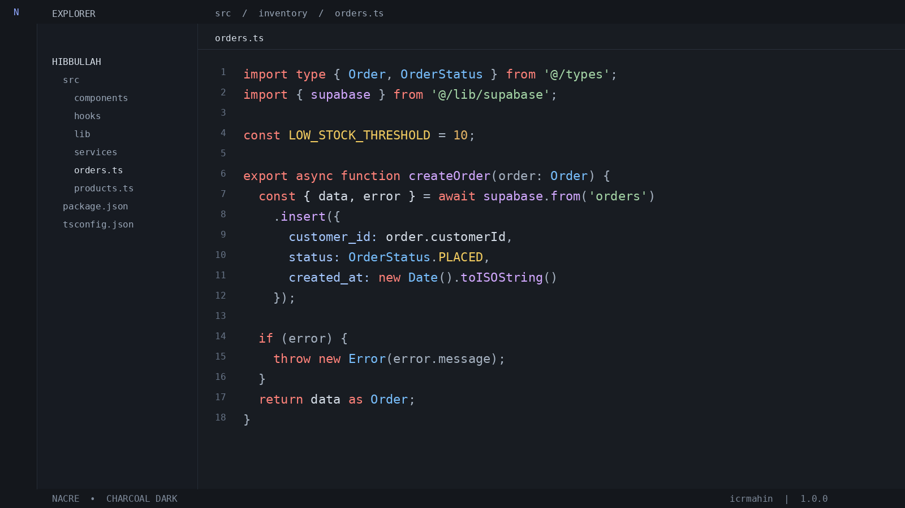

# Nacre for Visual Studio Code

**A premium dark workspace by [icrmahin](https://github.com/icrmahin).**

Nacre pairs a near-black `#0B0C0E` editor with restrained `#111214` graphite workspace surfaces and slightly raised `#17191C` panels. Its syntax palette is designed around a clear visual hierarchy: important language structure is easy to scan, related token roles stay coherent, and accents remain vivid without turning the editor into a rainbow.



## At a glance

| Item | Value |
| --- | --- |
| Extension ID | `icrmahin.nacre` |
| Version | `1.0.1` |
| Publisher / author | `icrmahin` / `ICRMAHIN` |
| Color theme | **Nacre** (single color variant) |
| File icon theme | **Nacre File Icons** |
| Product icon theme | **Nacre Product Icons** |
| Minimum VS Code engine | `^1.80.0` |
| License file | [`LICENSE.txt`](LICENSE.txt) |

## Install

### Install the packaged VSIX

Download the **icrmahin.nacre-1.0.1.vsix** asset from the [Nacre 1.0.1 GitHub Release](https://github.com/icrmahin/Nacre/releases/tag/v1.0.1), then run:

```bash
code --install-extension icrmahin.nacre-1.0.1.vsix
```

Alternatively, open **Extensions** in VS Code, select the `...` menu, choose **Install from VSIX...**, and select the downloaded file.

### Activate the themes

Use the Command Palette (`Ctrl+Shift+P` / `Cmd+Shift+P`) and select:

1. **Preferences: Color Theme** → `Nacre`
2. **Preferences: File Icon Theme** → `Nacre File Icons`
3. **Preferences: Product Icon Theme** → `Nacre Product Icons`

The color, file-icon, and product-icon themes are independent VS Code contributions. Activate each one separately.

## Visual system

### Surfaces

| Surface | Color | Intent |
| --- | --- | --- |
| Editor | `#0B0C0E` | Near-black neutral canvas |
| Main workbench surfaces | `#111214` | Deep graphite separation for sidebars, panels and chrome |
| Raised surfaces | `#17191C` | Subtle separation for menus, widgets and elevated panels |
| Primary text | `#E6EDF3` | Cool, readable near-white |

The full workbench color map lives in [`themes/nacre-color-theme.json`](themes/nacre-color-theme.json).

### Syntax hierarchy

The syntax palette takes inspiration from the role clarity of GitHub's dark editor themes without copying their palette one-to-one.

| Token role | Color | Purpose |
| --- | --- | --- |
| Keywords and control flow | `#FF7B72` | Coral structural emphasis |
| Functions and callable symbols | `#D2A8FF` | Lavender behavior/action emphasis |
| Types, classes and type-like names | `#FFA657` | Warm amber identity |
| Properties, constants and numeric values | `#79C0FF` | Clear blue data/reference emphasis |
| Strings | `#A5D6FF` | Cooler, lighter blue distinction |
| HTML/CSS tags and components | `#7EE787` | Green markup/component emphasis |
| Variables and primary text | `#E6EDF3` | Neutral baseline |
| Comments | `#8B949E` | Lower-priority explanatory text |

The theme defines TextMate scopes for common language constructs and several language-specific cases. Individual language extensions can provide additional semantic-token scopes; VS Code may use those semantic tokens alongside TextMate rules.

## Included features

### Nacre color theme

A single maintained color theme. The previous experimental color variants are not included in this release.

### GNOME and KDE system accent integration

On Linux, Nacre can automatically follow the desktop accent exposed by GNOME, KDE Plasma or a compatible Freedesktop appearance portal. GNOME 47+ uses its GSettings accent preference, while KDE prefers the appearance portal and falls back to `kdeglobals`. The integration gently tints workbench surfaces and accent states. It also blends just 2.5% of the desktop accent into existing TextMate and semantic syntax colors, keeping Nacre's original token roles and hierarchy. The `#0B0C0E` editor canvas stays neutral. One setting controls both behaviors: `nacre.systemAccent.enable`.

Nacre uses the accent supplied by the desktop. It does not claim to extract a dominant color from wallpaper when the desktop does not expose one. See [`docs/SYSTEM-ACCENT.md`](docs/SYSTEM-ACCENT.md) for sources, fallback behavior and limitations.

### Nacre File Icons

A file and folder icon theme with mappings for common file extensions, exact filenames, language IDs, and named folders. Its source mapping is [`themes/nacre-file-icons.json`](themes/nacre-file-icons.json); SVG assets are under [`icons/files/`](icons/files/) and [`icons/folders/`](icons/folders/).

### Nacre Product Icons

A separate product UI icon theme. It defines 171 product icon glyphs and loads the bundled `nacre-ui-icons.woff2` font through [`themes/nacre-product-icons.json`](themes/nacre-product-icons.json).

### Inline color-value highlighting

The extension code decorates supported color literals in visible text editors. It recognizes:

- Hex: `#RGB`, `#RGBA`, `#RRGGBB`, and `#RRGGBBAA`
- RGB/RGBA functional notation
- HSL/HSLA functional notation

Each recognized value receives a background matching the represented color and a calculated black or white foreground for legibility. The implementation debounces document-change updates and skips files larger than 500 KB.

Toggle the feature in VS Code settings:

```json
{
  "nacre.colorHighlight.enable": true
}
```

Set it to `false` to disable inline color decorations.

## Repository structure

```text
.
├── .github/workflows/              # validation, test VSIX and tag-based release workflows
├── docs/                           # design, architecture and release docs
├── icons/
│   ├── files/                      # file-type SVG artwork
│   └── folders/                    # folder SVG artwork
├── media/                          # preview and extension icon
├── releases/                       # VSIX, source archive and release bundle
├── scripts/validate.mjs            # local package/asset validator
├── tests/systemAccent.test.js      # GNOME/KDE parsing and workbench palette tests
├── tests/syntaxAccent.test.js       # syntax tinting, contrast and restoration tests
├── themes/
│   ├── nacre-color-theme.json      # workbench and syntax colors
│   ├── nacre-file-icons.json       # file/folder icon mappings
│   ├── nacre-product-icons.json    # product icon glyph map
│   └── nacre-ui-icons.woff2        # bundled product icon font
├── extension.js                    # extension lifecycle and feature coordination
├── systemAccent.js                 # GNOME/KDE detection and adaptive workbench palette
├── syntaxAccent.js                 # 2.5% TextMate and semantic syntax tinting
├── package.json                    # VS Code extension manifest
├── CHANGELOG.md
└── LICENSE.txt
```

For deeper explanations, see [`docs/`](docs/README.md).

## Build from source

Requirements:

- Node.js (current LTS recommended)
- Visual Studio Code Extension Manager (`@vscode/vsce`)

Validate the manifest and all referenced local assets:

```bash
npm run validate
```

Package the extension:

```bash
npx --yes @vscode/vsce package --out ./releases/icrmahin.nacre-1.0.1.vsix
```

The extension version is kept in `package.json`. A release build should only be made after updating the changelog and checking the complete validation report. Use the **Build Nacre Test VSIX (No Release)** workflow to validate and package a branch for local installation. It uploads a downloadable workflow artifact and does not publish a release. The release workflow is reserved for version tags.

## Validation status

The source validation script checks package identity, theme registrations, theme JSON, icon JSON, SVG paths, product-icon font references, and the one-color-theme release constraint. The release archive also contains the original QA summary and SHA-256 checksums.

A static package check is not the same as a live VS Code installation test. GitHub Actions validates and packages test builds. Live installation and UI rendering must still be verified in a real VS Code session, including GNOME and KDE accent changes, before a Marketplace release.

## Attribution and licensing

The project package is published under the `icrmahin` identity. The included `LICENSE.txt` retains the upstream MIT copyright notice present in the supplied icon/theme source (`nionx01`, 2026). Do not remove or alter required upstream notices when redistributing the included assets. See [`docs/ATTRIBUTION.md`](docs/ATTRIBUTION.md).

## Author

**ICRMAHIN** · [GitHub](https://github.com/icrmahin)
